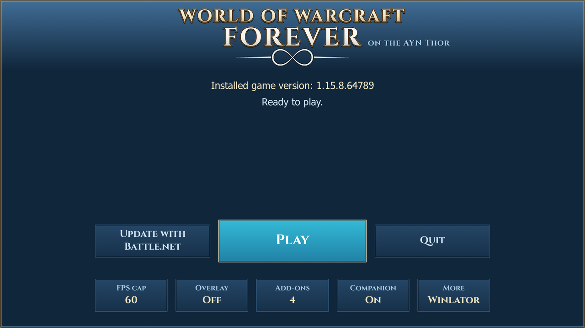
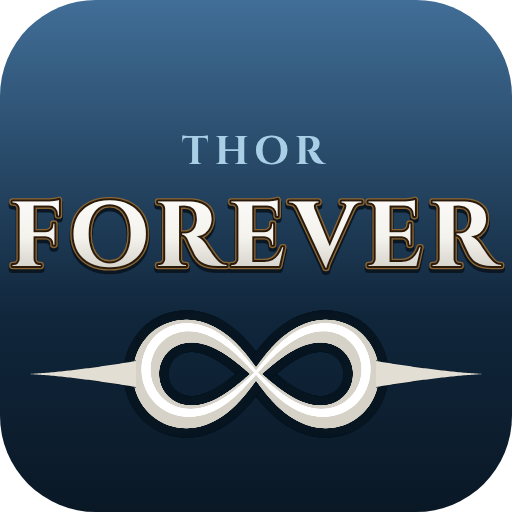
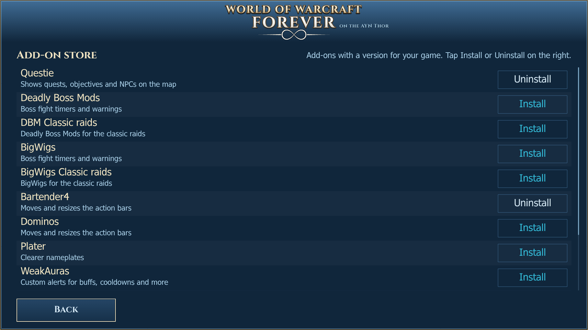
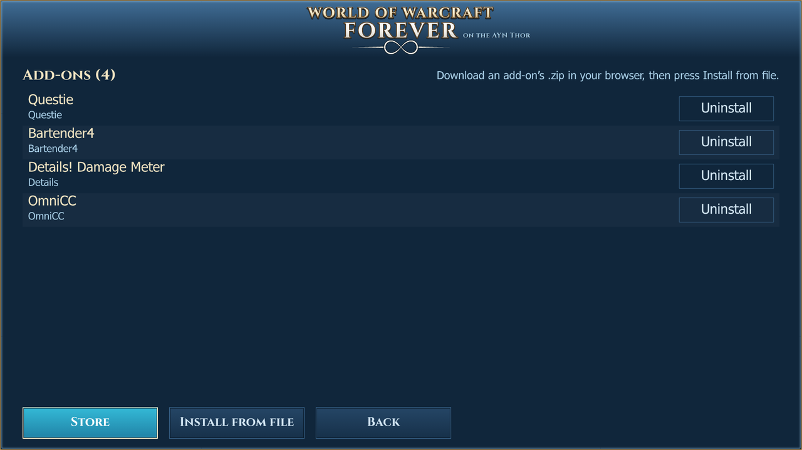

# Thor Forever

Thor Forever is an Android app that starts World of Warcraft: Forever on the AYN Thor with one tap.
It is a fork of Winlator Bionic (Winlator Ludashi) and comes with Wine, DXVK and a graphics driver already set up for the Thor.

## Status

This is a test version (alpha). It is tested on one AYN Thor.
The newest release is [v0.4.0](https://github.com/weltenaichaos/thor-forever-app/releases/tag/v0.4.0).
What changed in each release: [docs/RELEASE-NOTES.md](docs/RELEASE-NOTES.md).

Works, and was confirmed on the device:

- [x] A fresh install sets itself up and runs WoW
- [x] Battle.net: install, log in, install and update the game
- [x] Add-ons: install and uninstall
- [x] Full-screen start screen, and a loading screen that stays until the game's login screen shows
- [x] The app tells you when a new release is out, and installs it from inside the app
- [x] The Forever Companion on the Thor's second screen, built into the app (see [below](#forever-companion))
- [x] Chat lines from the companion go into the game in one go
- [x] **Exit** in the companion closes only the companion. The game keeps running.
- [x] The companion's map fills the bottom screen and shows quest areas in their real shape
- [x] The mouse cursor starts in the middle of the game's screen

New, still in testing:

- [ ] The companion's **Craft** tab (a first version)
- [ ] The map leads you back to your corpse after you die
- [ ] The map's **Turn with me** (the map turns with you, like the minimap)

Not done yet:

- [ ] The app does not check or help with the Android settings below. You set them yourself.

## Screenshots

The start screen, the add-on store and the installed add-ons. These pictures are drawn from the app's layout at the Thor's 1920×1080; photos from the device will replace them.

## How to install

### What you need

- An AYN Thor.
- Your own Battle.net account with access to World of Warcraft: Forever.
- An internet connection and a few GB of free space.

No game files are included. The game comes from Battle.net, as usual.

### Steps

1. Open the [Releases page](https://github.com/weltenaichaos/thor-forever-app/releases) on the Thor and download the `.apk` file of the newest release.
   Do not use **Code > Download ZIP**. That is only the source code.
2. Open the downloaded file. Android asks if your browser may install apps. Allow it, then install.
3. Open **Thor Forever**.
4. The first setup starts. Allow storage and notification access when the app asks.
   Then a screen installs Wine 11, DXVK 2.6.2 Thor and Turnip 26.2.3 from the app itself.
   Wait until it says "Everything is installed" and press **Continue**.
5. The start screen opens. Press **Install Battle.net**.
   The app downloads Blizzard's installer and starts it.
   If the download fails, download `Battle.net-Setup.exe` from battle.net/download in your browser, press **Choose installer** and pick the file.
6. Battle.net may show a white window for a minute while it loads. If it stays white, close it and try again.
7. Log in to Battle.net and install **World of Warcraft: Forever**. Choose the **ARM64** client if Battle.net asks.
8. Keep Battle.net open until the download is done. Then close Battle.net.
9. Back on the start screen, the app finds the game and adds it with the Thor settings. Press **Play**.

Later game updates: press **Update with Battle.net**. The start screen tells you when an update is waiting.

### Android settings you set yourself

The app cannot change these. Set them once before you play:

- **Disable child process restrictions.** In Developer options (Android 14 and newer). Without it, Android can stop Wine's helper processes, and WoW can crash at the login screen.
- **Battery: Unrestricted** for the app. Settings, Apps, Thor Forever, Battery.
- **Maximum performance mode with the fan up** on the Thor. In the standard mode the graphics chip runs much slower.

Details, and the commands for Android 12 and 13: [docs/THOR-SETUP.md](docs/THOR-SETUP.md).

### Next to other Winlator apps

Thor Forever is its own app (`com.thorforever.app`). It installs next to any Winlator or GameHub you already have and doesn't touch their data.

## Features

- **Start screen** in full screen: the installed game version, and the buttons **Play**, **Update with Battle.net** and **Quit**.
- **Loading screen:** it stays until the game shows its login screen, and comes back when you quit.
- **First setup by itself:** Wine, DXVK, the graphics driver, a container and the WoW shortcut with the settings that run well on the Thor. See [docs/THOR-SETUP.md](docs/THOR-SETUP.md) for the full list.
- **Battle.net:** install it from the start screen, and update the game with it.
- **Update check:** the start screen asks Blizzard's version server and says when a game update is waiting.
- **FPS cap:** Off, 30, 40, 45 or 60. The frames are timed to the screen refresh.
- **Overlay:** Off, FPS, or FPS with a graph.
- **Add-ons:**
  - A store with popular add-ons (Questie, Deadly Boss Mods, BigWigs, WeakAuras and more) and add-ons from WoWInterface. It shows only add-ons made for your game version.
  - Install an add-on from a `.zip` you downloaded in your browser.
  - Uninstall an add-on with one tap.
- **Companion:** turn the [Forever Companion](#forever-companion) on or off.
- **Updates:** Settings > **Check for updates** lists the published releases and installs the one you tap.
- **Crash reports:** WoW's crash reports are copied to `Winlator/logs/wow-errors`, where you can open them.
- **More:** opens the normal Winlator screens, for all other settings.
- The app closes the game session by itself when WoW quits.

## Forever Companion

The Forever Companion shows the game on the Thor's other screen, and lets you do things in the game with a tap.
It is built into the app. Turn it on with the **Companion** button on the start screen.
The app then puts the companion's add-on into the game and opens the companion on the other screen when WoW starts.
Turned off, the companion stays closed and its add-on is removed.

Its tabs:

- **Bags:** everything in your bags. Tap an item to use it. Hold it to see its details; gear is compared with what you wear.
- **Character:** your level, gold, item level and gear, with a warning when your gear needs repair, and the spells waiting at your trainer.
- **Quests:** your quests and what is left to do. **Errands** groups the finished quests by the place where you hand them in.
- **Craft:** your professions and recipes, and what you can make from your bags. **Make one**, **Make 5** and **Make all** start the game's own crafting. A crafting list makes several recipes one after another.
- **Map:** the zone with you on it, over the whole bottom screen. Drag, pinch or use **+** and **−**. Tap a pin or a quest area to see how far and which way it is, and **Lead me there**. After you die, the map opens by itself and leads you back to your corpse.
- **Chat:** the game's chat in tabs (All, Group, Whispers, Guild, General). Type or speak a line, and it goes into the game.

At the login screen, a **Type in the game** box lets you type your account name or password on the bottom screen. The password is never shown or saved.

**Exit** closes only the companion. The game keeps running.

How it works: the add-on draws small colour squares in the corners of the game's screen, and the companion reads them from the picture. It also follows the game through its files. Everything the companion does in the game starts with a tap from you.

The companion started as [thor-companion](https://github.com/weltenaichaos/thor-companion) and is developed here now. More: [docs/COMPANION.md](docs/COMPANION.md).

## Troubleshooting and logs

- The app writes its logs to the `Winlator/logs` folder.
- WoW writes its own crash reports to the `Errors` folder next to `WowB-ARM64.exe`. The app copies them to `Winlator/logs/wow-errors`, where you can open them.
- Something wrong in the companion? Hold its status line (the line with the coloured dot, near the top). It saves the Thor's recent log and a picture of the game's screen in `Download` (`ForeverCompanion-log.txt` and `ForeverCompanion-screen.png`).
- Logs and WoW's `WTF` and `Account` folders can contain account and character names. Don't post them publicly.

More help: [docs/THOR-SETUP.md](docs/THOR-SETUP.md).

## Credits

Thor Forever builds on the work of many people:

- **Original Winlator** by [brunodev85](https://github.com/brunodev85/winlator)
- **Original Winlator Bionic** by [Pipetto-crypto](https://github.com/Pipetto-crypto/winlator)
- **Winlator Ludashi** by [StevenMXZ](https://github.com/StevenMXZ/Winlator-Ludashi), the version this app is forked from
- **Winlator (coffincolors fork)** by [coffincolors](https://github.com/coffincolors/winlator)
- **Thor Forever** by [AeroNico](https://github.com/AeroNico/thor-forever): the original investigation that got WoW: Forever running on the Thor
- **Forever Companion**: [weltenaichaos/thor-companion](https://github.com/weltenaichaos/thor-companion)
- Ubuntu RootFs (Bionic Beaver): [releases.ubuntu.com/bionic](https://releases.ubuntu.com/bionic)
- Wine: [winehq.org](https://www.winehq.org/)
- Box86/Box64 by [ptitseb](https://github.com/ptitSeb)
- FEX-Emu by [FEX-Emu](https://github.com/FEX-Emu/FEX)
- PRoot: [proot-me.github.io](https://proot-me.github.io)
- Mesa (Turnip/Zink/VirGL): [mesa3d.org](https://www.mesa3d.org)
- DXVK: [github.com/doitsujin/dxvk](https://github.com/doitsujin/dxvk)
- VKD3D: [gitlab.winehq.org/wine/vkd3d](https://gitlab.winehq.org/wine/vkd3d)
- D8VK: [github.com/AlpyneDreams/d8vk](https://github.com/AlpyneDreams/d8vk)
- CNC DDraw: [github.com/FunkyFr3sh/cnc-ddraw](https://github.com/FunkyFr3sh/cnc-ddraw)
- Cinzel font (SIL Open Font License)
- Thanks also to [Danylo](https://blogs.igalia.com/dpiliaiev/tags/mesa/) (Turnip), [alexvorxx](https://github.com/alexvorxx) (mods and tips) and others.

Licences: see [LICENSE](LICENSE) and the [notices](notices/) folder. Third-party parts keep their own licences.

Thor Forever is not affiliated with or endorsed by Blizzard Entertainment or AYN.
World of Warcraft is a trademark of Blizzard Entertainment, Inc.
